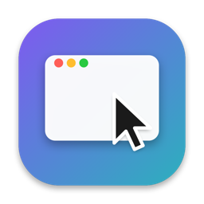
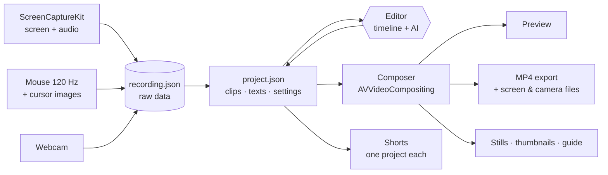

<div align="center">



# ScreenFrame

### Record raw. Polish later.

A native macOS screen recorder with auto zooms, a buttery cursor and studio backgrounds,<br>
plus an AI editor that cleans up, cuts, subtitles and turns one video into a week of content.

<br>


<br>

**[Quick start](#quick-start)** &nbsp;·&nbsp; **[Highlights](#highlights)** &nbsp;·&nbsp; **[Features](#features)** &nbsp;·&nbsp; **[Shortcuts](#shortcuts)** &nbsp;·&nbsp; **[CLI](#cli)** &nbsp;·&nbsp; **[Architecture](#architecture)**

</div>

<br>

---

<a id="highlights"></a>

## ⚡ Highlights

<table>
<tr>
<td width="33%" valign="top" align="center">
<br>
<h3>🔍</h3>
<b>Auto zoom</b><br>
<sub>Zooms in where you click and follows the cursor, with springs tuned like Screen Studio</sub>
<br><br>
</td>
<td width="33%" valign="top" align="center">
<br>
<h3>🤖</h3>
<b>Edit by prompt</b><br>
<sub>"Cut the intro, zoom on the settings, add a title." Claude does it as one undo step</sub>
<br><br>
</td>
<td width="33%" valign="top" align="center">
<br>
<h3>✂️</h3>
<b>Edit by script</b><br>
<sub>Delete words from the transcript and they're gone from the video</sub>
<br><br>
</td>
</tr>
<tr>
<td width="33%" valign="top" align="center">
<br>
<h3>📱</h3>
<b>1–8 Shorts per video</b><br>
<sub>Claude finds the moments that stand on their own and builds 9:16 shorts with captions and a hook</sub>
<br><br>
</td>
<td width="33%" valign="top" align="center">
<br>
<h3>↺</h3>
<b>Take again</b><br>
<sub>Fluffed a sentence? Press ⌘⇧1, say it again. The bad take is cut for you</sub>
<br><br>
</td>
<td width="33%" valign="top" align="center">
<br>
<h3>🛡</h3>
<b>Privacy auto-blur</b><br>
<sub>Emails, phone numbers, API keys, names and faces found and blurred on-device</sub>
<br><br>
</td>
</tr>
<tr>
<td width="33%" valign="top" align="center">
<br>
<h3>💬</h3>
<b>Subtitles that learn</b><br>
<sub>On-device speech, a glossary for your names, and Claude proofreading that teaches it</sub>
<br><br>
</td>
<td width="33%" valign="top" align="center">
<br>
<h3>📦</h3>
<b>Content package</b><br>
<sub>Titles, chapters, YouTube description, LinkedIn post, newsletter snippet, thumbnails</sub>
<br><br>
</td>
<td width="33%" valign="top" align="center">
<br>
<h3>🎨</h3>
<b>Brand kits</b><br>
<sub>Your fonts, colours, gradient, logo, lower third, intro and outro in one click</sub>
<br><br>
</td>
</tr>
</table>

<br>

<a id="quick-start"></a>

## 🚀 Quick start

```bash
./build.sh          # build .build/ScreenFrame.app
./build.sh --run    # build, install to /Applications, launch
```

> [!NOTE]
> **First launch:** allow ScreenFrame under *System Settings › Privacy & Security › Screen & System Audio
> Recording*, then press **Relaunch**. Builds are signed with the local "Flow App Signing" identity, so
> the grant survives rebuilds.

No Xcode project, no API key. AI features run through your local Claude Code login.

Design notes from the Screen Studio teardown live in `~/screenstudio-re/BLUEPRINT.md`.

<br>

---

<a id="features"></a>

# ✨ Features

<br>

## 🎥 Capture

*Hit ⌘⇧2 and talk. Everything else can be fixed later.*

- **Record anything:** a full display, a single window, or an area you drag out
- **60 fps HEVC** via ScreenCaptureKit. The system cursor is hidden and redrawn later, so it can be smoothed, scaled or hidden
- **3‑2‑1 countdown** on the display you're recording, never captured itself
- **Live mic meter** before you start, so a muted or wrong mic shows up before you waste a take
- **Separate audio lanes** for your mic and system audio, each with its own volume
- **Webcam bubble** you can drag around while recording. Its path is replayed spring-smoothed in the edit
- **Floating stop pill** with a timer, left out of the recording. The mouse move to Stop is trimmed off automatically
- **↺ Take again (⌘⇧1):** mark a retake, say the sentence again, and on stop the last sentence before each mark is cut
- **Typing detection** (opt-in, records key-press *times* only) for "speed up typing" in the edit
- **Menu-bar icon** to stop from anywhere
- **Bring your own footage:** import `.screenstudio` projects, or drop any video files on the home window to start a project

<br>

## 🎬 Polish

*The Screen Studio look without touching a keyframe.*

- **Auto zoom on clicks:** nearby clicks are grouped into one zoom that starts just before you act
- **Follow cursor or fixed point:** each zoom follows the mouse, or you drag a frame over a still to pick exactly what it shows
- **Spring-smoothed cursor** with adjustable size, click squish and ripple highlight, or hide it completely
- **Studio backgrounds:** Aurora, Sunset, Ocean, Candy, Forest, Peach, Lime, Midnight, Graphite, Paper, or your own wallpaper
- **Padding, rounded corners, drop shadow and motion blur**
- **Any aspect:** source, 16:9, 1:1, 9:16, 4:3, with *fill frame & follow cursor* to reframe a wide recording for vertical
- **Export in 1080p, 4K or native resolution**

<br>

## 🎞 Timeline

*A real multi-clip editor, not just a trimmer.*

- **Multi-clip:** add more recordings or video files, then split, trim, reorder and duplicate
- **Speed per clip** (pitch kept) and **volume per clip and per lane**, with waveforms on the timeline
- **Transitions:** crossfade, fade through black, slide
- **Text overlays:** pill, outline, shadow or plain, UPPERCASE, dragged right on the preview, with a soft fade-and-rise
- **Camera lane with keyframes:** the bubble glides to a new spot or switches layout mid-clip
- **Right-click everything** for speed, volume, camera layout, transitions, duplicate and delete
- **Undo / redo everything.** Drags and slider moves are merged into one step
- **Activity strip** shows every long task with progress and time on the preview

<br>

## 📷 Camera

*You, framed like a pro, even on a laptop webcam.*

- **Shapes:** circle, rounded square or 16:9, any size, any corner, mirrored or not
- **Layouts per clip:** overlay bubble, fullscreen, **split** (screen on top, you below) or hidden, changed mid-clip with keyframes
- **Keep my face centred:** Vision face tracking reframes the camera around you
- **Cut me out of the camera:** person segmentation blurs or removes your background
- **Auto layout:** goes fullscreen on you while you talk and nothing happens on screen

<br>

## 🤖 AI editor

*Describe the edit. Or just delete the words.*

- **Edit with AI:** write what you want ("cut the first 10 seconds, zoom on the sidebar, add a title 'Setup'"). Claude can cut, split, speed up, zoom, add or remove texts, move the camera, change volumes, transitions and settings, remove silences, add captions and blur sensitive info, all applied as **one undo step**
- **Edit by script:** the transcript as clickable words. Click to jump, shift-click to select, <kbd>⌫</kbd> to cut those words from the video
- **Clean up:** finds pauses and filler words. Silent parts where you click or type are kept. Suggested cuts show red on the timeline; click a strip to keep it
- **Speed up typing:** stretches where you were typing play back faster

<br>

## 💬 Subtitles

*Accurate captions that get better every video.*

- **On-device transcription** with Apple Speech in several languages. Nothing is uploaded
- **Subtitle editor** in its own window: every line editable and playable, find & replace across all
- **Glossary** (app-wide): your names and product terms become vocabulary hints and fixes for every transcript
- **✦ Fix with Claude:** proofreads names, spelling and punctuation without rewording, marks what changed, and offers to **teach the glossary** so it's right next time
- **One caption style for all lines:** font, colours, background, size, width and position, kept when you regenerate

<br>

## 📱 Social: YouTube Shorts on autopilot

*One recording in, a stack of ready-to-post shorts out.*

- **Make 1–8 shorts per video**, quick (15–30 s), standard (30–60 s) or long (1–3 min). Claude picks moments that work on their own; making more skips moments you already have
- **Every short is a full project:** edit cuts, captions, titles and camera like any other video
- **Layouts:** split (screen on top, you below), bubble, camera only, screen only
- **Short styles:** Clean, Bold, Minimal, Pop, one per brand kit, plus your own saved presets
  - **Captions:** pill / outline / shadow / plain, font, text and box colours, size, UPPERCASE, position
  - **Hook title:** text, style, colours, size, how long it stays on screen
  - **Progress bar** (solid or brand gradient, top or bottom), split ratio and divider line, logo, background, frame
  - Choose one for new shorts, fine-tune it per short, or apply one style to all shorts of a video
- **Post text included:** title, description and hashtags per short, editable from the original or the short itself
- **Export one or all** to `Movies/<video> – Shorts/NN Title.mp4`, each with a `.txt` of the post text

<br>

## 📦 Publish

*Everything you need to ship the video, generated from the video.*

- **MP4 export, three files in sync:** the final video, the screen alone, and the camera full frame, ready for another editor
- **🛡 Privacy auto-blur:** on-device OCR finds emails, phone numbers, keys and tokens, full names and faces and blurs them. Toggle each one or a whole kind, or add your own
- **🎨 Brand kits:** background, fonts, colours, logo watermark, lower third, intro and outro cards in one click
- **Content package:** titles, chapters, YouTube description, LinkedIn post and newsletter snippet, plus `chapters.txt` and `captions.srt`
- **Thumbnail generator:** picks strong frames (face + detail), writes a headline, cuts you out, adds your logo, then exports YouTube, LinkedIn and square sizes
- **Step-by-step guide:** one step per click with a marked screenshot, the clicked label (OCR) and text by Claude, as HTML, Markdown and PDF

<br>

---

## 🔁 How it fits together



The raw recording never changes. Every edit goes into `project.json`, and one custom compositor
renders the preview, the export and the stills, so what you see is exactly what you get.

<br>

<a id="shortcuts"></a>

## ⌨️ Shortcuts

<table>
<tr>
<td valign="top">

| Anywhere | |
|---|---|
| <kbd>⌘</kbd> <kbd>⇧</kbd> <kbd>2</kbd> | Start / stop recording |
| <kbd>⌘</kbd> <kbd>⇧</kbd> <kbd>1</kbd> | Take again: cut the sentence you just said |

The menu-bar icon also stops a recording.

</td>
<td valign="top">

| In the editor | |
|---|---|
| <kbd>Space</kbd> | Play / pause |
| <kbd>Z</kbd> | All zooms on / off |
| <kbd>T</kbd> | Add text |
| <kbd>B</kbd> / <kbd>⌘</kbd> <kbd>B</kbd> | Split at playhead |
| <kbd>⌘</kbd> <kbd>D</kbd> | Duplicate |
| <kbd>⌫</kbd> | Delete the selection |
| <kbd>⌘</kbd> <kbd>Z</kbd> / <kbd>⇧</kbd> <kbd>⌘</kbd> <kbd>Z</kbd> | Undo / redo |
| <kbd>←</kbd> <kbd>→</kbd> | Step a frame (with <kbd>⇧</kbd>: a second) |
| <kbd>⌘</kbd> <kbd>E</kbd> | Export |

</td>
</tr>
</table>

**Right-click** anything on the timeline for speed, volume, camera layout, transitions, duplicate and
delete. `open -a ScreenFrame <project>` opens a project folder.

Each zoom either follows the cursor or holds a fixed focus point (`focusX`/`focusY`, normalized,
top-left origin) chosen by dragging the zoom frame over a still in the inspector.

<br>

<a id="cli"></a>

## 💻 CLI

Almost everything the app does also runs headless, which is handy for scripts and agents.

<details open>
<summary><b>Record & import</b></summary>

```bash
ScreenFrame --record <seconds> [window=<id>|area=x,y,w,h] [system-audio]
ScreenFrame --list-windows
ScreenFrame --import <x.screenstudio>
ScreenFrame --from-video <video> [more videos …]        # new project from video files
ScreenFrame --add-clip <project> <video file or recording folder>
```

</details>

<details open>
<summary><b>Edit & AI</b></summary>

```bash
ScreenFrame --ai <project> "<request>"                  # edit by prompt
ScreenFrame --pauses <project> [apply]                  # find (and cut) pauses
ScreenFrame --retakes <project> <seconds> [seconds …]   # cut retakes at these marks
ScreenFrame --cut-words <project>                       # test edit-by-script
ScreenFrame --brand <project>                           # apply the first brand kit
ScreenFrame --privacy <project>                         # scan & blur sensitive info
```

</details>

<details open>
<summary><b>Subtitles & analysis</b></summary>

```bash
ScreenFrame --transcribe <audio or video file> [de-DE|en-US|…]
ScreenFrame --subs <project> [claude]                   # generate subtitles, optionally Fix with Claude
ScreenFrame --faces <camera video>
```

</details>

<details open>
<summary><b>Shorts</b></summary>

```bash
ScreenFrame --shorts <project> [count] [length=quick|standard|long] [layout=split|bubble|camera|screen] [lang=…]
ScreenFrame --export-shorts <project>
ScreenFrame --short-style <short or video> <style name>          # e.g. snipKI, Bold
```

</details>

<details open>
<summary><b>Publish</b></summary>

```bash
ScreenFrame --export <project> <out.mp4> [parts=1] [key=value ...]   # e.g. aspect=square background=sunset
                                                     # parts=1: also "<out> - Screen.mp4" and "<out> - Camera.mp4"
ScreenFrame --still  <project> <seconds> <out.png> [key=value ...]
ScreenFrame --content <project>                         # content package
ScreenFrame --thumbs <project>                          # thumbnails
ScreenFrame --guide <project>                           # step-by-step guide
ScreenFrame --snapshot <project> [tab] [out.png] [height] [light]   # debug: render the inspector to PNG
```

</details>

<br>

## 🧠 AI under the hood

AI features call Claude through the newest local **Claude Code** binary
(`-p --output-format json --tools ""`), so they use your own auth (including Bedrock). No extra API
key is needed. Claude gets the project and transcript as JSON and returns a whitelisted list of
operations, which the editor applies as one undo step.

Transcription, face tracking, OCR and background segmentation run **on-device** with Apple frameworks.
Video and audio never leave the Mac. Claude only sees text: the transcript, project data and, for guides, the OCR'd labels of what you clicked.

<br>

<a id="architecture"></a>

## 🏗 Architecture

<details>
<summary><b>Capture & input</b></summary>

| Stage | Where | What |
|---|---|---|
| Capture | `Capture/Recorder.swift` | ScreenCaptureKit (display, single window, or dragged area via `AreaSelector`), system cursor hidden, HEVC `.mov`; system audio + mic to separate `.m4a` with offsets |
| Input | `Capture/InputSampler.swift` | 120 Hz mouse/button polling on the host clock (no Accessibility permission), cursor images deduped to `cursors/*.png` |
| Typing | `Capture/InputSampler.swift` | opt-in key-press *times* (no keys, needs Accessibility) → "Speed up typing" splits those stretches to a faster clip speed |
| Webcam | `Capture/WebcamRecorder.swift`, `Render/RenderModel.swift` | AVCaptureSession → H.264 `webcam.mov` on the host clock; the draggable preview bubble's position is logged (`webcamPath`) and replayed spring-smoothed; in the editor drag the bubble anywhere or pick a corner; circle / square / 16:9, size, mirror; per clip overlay / fullscreen / hidden |
| Stop control | `Home/RecordingControls.swift` | floating pill with timer + Stop while recording (not captured); clicks on own controls aren't recorded, the move to Stop is trimmed off the clip |
| Take again | `Analysis/Retakes.swift` | ⌘⇧1 or ↺ in the stop pill marks a retake; on stop the 15 s before each mark are transcribed and the last sentence (punctuation, else the biggest word gap / voice pause) is cut |
| Import | `Import/ScreenStudioImporter.swift` | converts `.screenstudio` projects (video, audio, mouse logs, cursor PNGs) |
| Video projects | `Model/ProjectStore.swift` (`createProject(fromVideos:)`) | "Open Video…", drop on the home window, or open a video with ScreenFrame: first file becomes the project's recording (its audio as the voice lane), the rest clips |

</details>

<details>
<summary><b>Model & timeline</b></summary>

| Stage | Where | What |
|---|---|---|
| Model | `Model/` | project folder = `recording.json` (immutable raw data) + `project.json` (clips, texts, settings) + media; added clips are copied into `clips/` (recordings) and `media/` (video files) |
| Timeline | `Model/TimelineLayout.swift` | shared by editor and composer: clip speed stretches a clip (pitch kept, `.spectral`), a transition overlaps it with the next |
| Camera lane | `Model/EditSettings.swift` (`CameraKey`), `Render/RenderModel.swift` | timeline keyframes: from each one the bubble glides (0.5 s) to a position and/or switches overlay / fullscreen / hidden (0.35 s fade); dragging the bubble on the preview sets the keyframe at the playhead. Positions carry across clips, layouts don't: each clip starts in its own layout and its keyframes change it mid-clip ("Change Camera at Playhead" in the clip's right-click menu) |
| Undo | `Editor/EditorModel.swift` | snapshot stack of settings/clips/texts; changes within 0.6 s coalesce (drags, sliders) |
| Activity strip | `Editor/EditorModel.swift` (`begin/report/end`), `ActivityStrip` | every long task registers by id: shown with progress and elapsed time on the preview, a second start is refused with a notice, transcription is shared between features |

</details>

<details>
<summary><b>Rendering</b></summary>

| Stage | Where | What |
|---|---|---|
| Playback/export | `Render/Composer.swift` | one custom `AVVideoCompositing` drives AVPlayer preview, AVAssetExportSession (H.264 MP4) and stills |
| Separate files | `Render/Composer.swift` (`RenderVariant`, `Exporter.exportAll`) | with a camera, export also renders `<name> - Screen.mp4` (no camera, titles, captions or logo) and `<name> - Camera.mp4` (camera full frame, black where a clip has none) on the same timeline, so all three line up frame for frame; a checkbox in the save panel turns it off |
| Clips | `Render/Composer.swift` | clips play back to back on two alternating video tracks, one RenderModel per clip; zooms live on the clip in source time |
| Transitions | `Render/Composer.swift` | crossfade, fade through black, slide; two-layer instructions over the overlap |
| Audio | `Render/Composer.swift`, `Render/Waveform.swift` | A/B composition tracks per lane (voice, system, clip audio); `AVAudioMix` applies lane volume × clip volume, fades across transitions; waveform peaks for the timeline |
| Effects | `Render/RenderModel.swift` | background + shadow + rounded mask (pre-rendered), spring-smoothed cursor, click squish + ripple, spring camera that follows the cursor during zoom segments |
| Auto zoom | `Render/AutoZoom.swift` | clicks grouped by time (≤3 s) and distance (≤35 % of diagonal), zoom starts 0.9 s before |
| Text | `Render/TextRenderer.swift` | CoreText sprites (pill / shadow / plain), drawn in output space after the camera, 0.25 s fade-and-rise |
| Captions | `Render/Captioner.swift` | audio read as 16 kHz mono from any file, split at quiet points (<55 s), each chunk level-normalized (+30 dB max), Apple Speech on-device → words → subtitle lines |
| Brand kit | `Model/BrandKit.swift`, `Render/CardRenderer.swift` | app-wide kits (Application Support/ScreenFrame): gradient, font, colours, logo watermark, lower third, intro/outro cards rendered to MP4 and added as full-bleed clips; default "snipKI" from the snipki-design skill |

</details>

<details>
<summary><b>Analysis & AI</b></summary>

| Stage | Where | What |
|---|---|---|
| Smart camera | `Analysis/FaceTracker.swift`, `Analysis/SmartCamera.swift` | Vision face track (cached `webcam.mov.faces.json`) keeps the face centred; person segmentation blurs or removes the background; "Auto layout" goes fullscreen while talking without screen activity |
| Clean up | `Analysis/Cleanup.swift`, `Model/EditOps.swift` | pauses from the voice level (keeps silent demos with clicks/typing/mouse), filler words from the transcript; cuts preview red on the timeline; `EditOps` cuts/splits/retimes and moves titles, captions and camera keys with the content |
| Privacy | `Analysis/PrivacyScanner.swift` | Vision OCR at 1 fps (unchanged frames skipped): emails, phone numbers, keys/tokens, full names (two capitalised words, UI words excluded), faces → `BlurRegion`s, rendered as average-pixelate-blur |
| Edit by prompt | `Analysis/AIClient.swift`, `Analysis/AIEditor.swift` | Claude via the newest local Claude Code binary (`-p --output-format json --tools ""`, so the user's own auth/Bedrock); project + transcript as JSON in, a whitelisted operation list out, applied as one undo step |
| Social | `Editor/EditorModel+Social.swift`, `Editor/SocialViews.swift`, `Analysis/ShortsPlanner.swift`, `Model/Social.swift` | Social tab: Claude picks N non-overlapping shorts from the transcript (hook, YouTube title, description, hashtags; without AI the windows with most speech); each is copied to its own project (APFS clone), cut with `EditOps`, set to 9:16 with captions rebuilt in a vertical style and a hook title. Post text lives in `social.json` beside project.json (so the short's window and the original's list can both edit it), linked to the original by path; export writes MP4 + .txt to `Movies/<video> – Shorts/` |
| Short styles | `Model/ShortStyle.swift`, `Editor/ShortStyleViews.swift` | a `ShortStyle` preset is written into the short's settings and texts (caption style, hook text marked `hook`, `progressBar`, `splitRatio`, `splitDivider`, watermark, background, padding) and read back from them for the editor, so every detail stays editable and undoable; built-ins, one per brand kit, saved ones in `shortstyles.json`; text style `outline` and `uppercase` in `TextRenderer`, progress bar drawn by the compositor |
| Split layout | `Render/RenderModel.swift` (`splitFrame`) | camera layout `split`: a second RenderModel renders the screen (fill & follow, zooms, cursor) into the top 58% (vertical) or left 62% (landscape), the face-centred camera fills the rest; fades like the other layouts |
| Script editing | `Editor/PublishViews.swift` (`TranscriptPanel`) | on-device transcript as clickable words; shift-click selects, ⌫ cuts the words from the video (`EditOps.remove`) |
| Subtitles | `Editor/SubtitleEditor.swift`, `Model/Glossary.swift` | own window: every line editable and playable, find & replace across all; glossary (app-wide) gives the recognizer vocabulary hints and fixes every transcript (phrase-level, after splitting multi-word segments); "Fix with Claude" proofreads names/spelling/punctuation without rewording, marks changes, and can teach the glossary what it corrected |
| Caption style | `Model/EditSettings.swift` (`CaptionStyle`), `Editor/EditorModel+Subtitles.swift` | one look for all subtitles (style, position, size, width, font, text and background colour), saved in the project so generated captions get it; changing one property keeps per-line tweaks of the others; "Use This Style for All Subtitles" copies one line's look; brand kits set its font |
| Content package | `Analysis/ContentPackager.swift` | Claude writes titles, chapters, YouTube description, LinkedIn post and newsletter snippet (LinkedIn/newsletter in the jens-voice style) → `content/` with content.md, chapters.txt, captions.srt |
| Thumbnails | `Analysis/ThumbnailMaker.swift` | frame candidates scored by face + detail, headline by Claude, face cut-out (person segmentation around the largest face), brand logo → YouTube / LinkedIn / square PNGs in `thumbnails/` |
| Step guide | `Analysis/GuideMaker.swift` | one step per click: screenshot with marker, clicked label via OCR, text by Claude → `guide/` index.html, guide.md, guide.pdf |

</details>

<br>

## 🗺 Roadmap

- [x] Camera layouts that change mid-clip
- [x] Caption styling for all captions at once
- [x] Multiple YouTube Shorts per video with styles
- [x] Screen and camera exported as separate, synced files
- ~~GIF export~~ (not wanted)

<br>

---

<div align="center">


<sub>Built with ScreenCaptureKit, AVFoundation, Core Image, Vision and Apple Speech.<br>Made in Germany 🇩🇪</sub>

</div>
